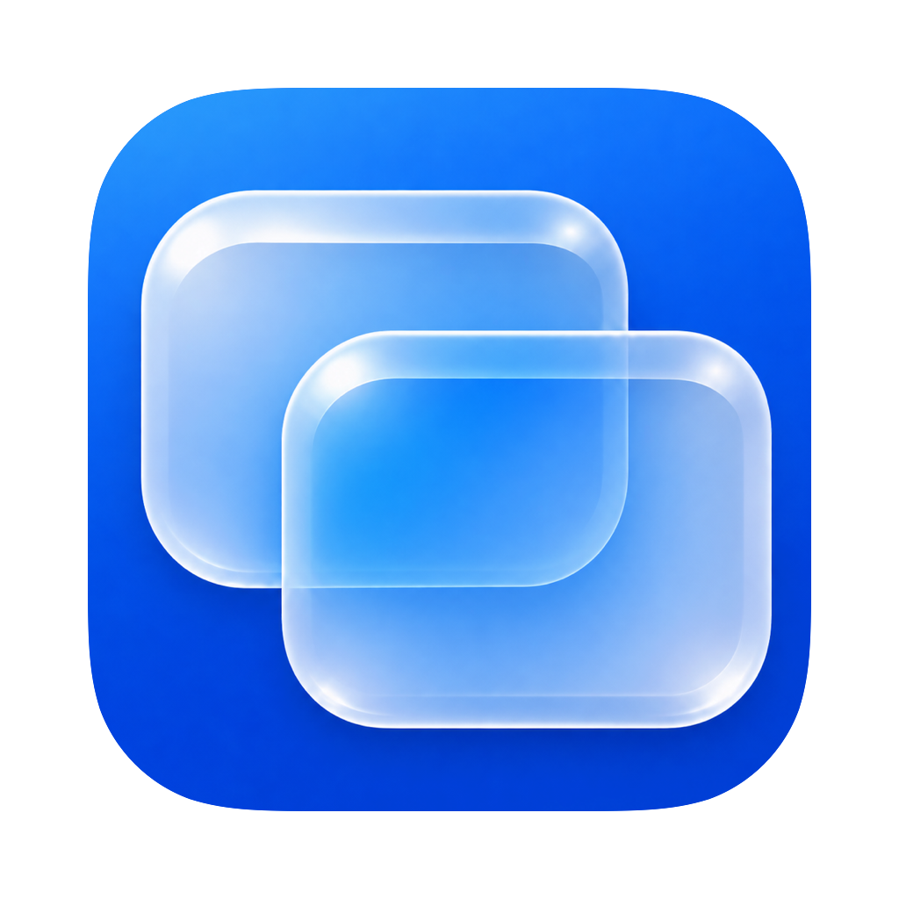

<p align="center"></p>

# WindowSwitch

[](https://github.com/morefreefg/WindowSwitch/actions/workflows/build.yml)
[](LICENSE)

A native macOS window switcher with fast quick taps, static window previews, and display-aware focus. Built with Swift, AppKit, and SwiftUI. macOS 14 or later; Universal binaries for Apple silicon and Intel.

## Features

- Quick tap the configured shortcut to toggle between the two most recent eligible apps/windows on the screen under the mouse. Hold to show the full list.
- One recent window per app by default. Disable this in General to list every window; the current-app shortcut always keeps all of that app's windows.
- Shared recent-window ordering for quick switching, the full list, and Dock focus, including focus changes outside WindowSwitch.
- Filter by display, Space, hidden/minimized state, application, and window title.
- High quality previews use the display's pixel scale. Static caches are reused; previews do not run as live video streams.
- Optional idle-time background preloading, off by default, with a configurable interval and small low-priority thumbnails. Busy, hot, or low-power systems pause or slow this work.
- Dock clicks focus an eligible window on the clicked display, preserving windows on other displays.
- Configurable fade durations, native settings, menus, and Liquid Glass on supported macOS versions.
- Window close, minimize, fullscreen, layout, and Space actions; optional native app-switcher window previews.
- No update checker, analytics, crash uploads, or account requirement.

## Install

Download the Universal DMG from [Releases](https://github.com/morefreefg/WindowSwitch/releases/latest), open it, and drag WindowSwitch to Applications.

Open Settings → Permissions. Accessibility is needed to list/control windows; Screen Recording is needed for thumbnails. Already-granted permissions are detected. Audio is not recorded. Quit other window-switching utilities before enabling overlapping shortcuts.

The initial release uses an **ad-hoc signature and is not Apple-notarized**. macOS may require explicit approval in System Settings → Privacy & Security. This is not a Developer ID signature. See [release signing](Docs/Releasing.md) for the optional Developer ID/notarization setup.

Defaults: Command+Tab for the window list, Option+` for the current application's windows. Quick tap is enabled, with a 200 ms hold threshold. Shortcuts and display filters are configurable.

## Build

Install Xcode 27 and [XcodeGen](https://github.com/yonaskolb/XcodeGen), then:

```sh
brew install xcodegen
./Scripts/test.sh
./Scripts/build.sh
./Scripts/package.sh
```

Build products use a temporary directory; `dist/` contains the Universal DMG, ZIP, checksums, and build manifest. Builds are ad-hoc signed unless `WINDOWSWITCH_SIGNING_IDENTITY` is explicitly supplied. No local certificate is selected or exported automatically.

## Keyboard actions inside the list

| Input | Action |
| --- | --- |
| Tab / Shift+Tab | Next / previous |
| Arrow keys / H J K L | Navigate |
| Enter / Escape | Confirm / cancel |
| W / Delete | Close selected window |
| M / F / C | Minimize / fullscreen / center |
| Shift+arrows | Window layouts |
| Space | Bring window to the current Space |
| N / T | New window / tab in the selected app |
| R / P | Recent documents / settings |
| / | Search the list |

## Privacy and compatibility

Preferences and thumbnail caches stay on the Mac; thumbnails are held in memory. Recent documents and browser shortcuts are read locally only when their corresponding features are used. System permission prompts remain under macOS control.

Some window focus, Space, and drawing operations depend on private macOS interfaces. Symbols are checked at runtime; OS updates may affect those features. Headless CI cannot validate cross-app Accessibility or multi-display input behavior. See [architecture and validation](Docs/Architecture.md).

## 中文说明

原生 macOS 窗口切换工具。短按切换鼠标所在屏幕最近两个候选项，长按显示列表；默认每个应用只显示最近窗口。General 可切回全部窗口。High 按屏幕像素生成缩略图；后台预加载默认关闭，开启后仅在空闲且低负载时低优先级执行。Dock 点击只聚焦当前屏幕窗口，不修改系统 Dock 偏好。

首次使用请在设置中完成辅助功能和屏幕录制授权；已授权的项目不会重复请求。应用不录制音频，不包含自动更新或统计上报。

## License

MIT. Third-party copyright and license notices are retained in [ThirdPartyNotices](Docs/ThirdPartyNotices.md) and the vendored package.
